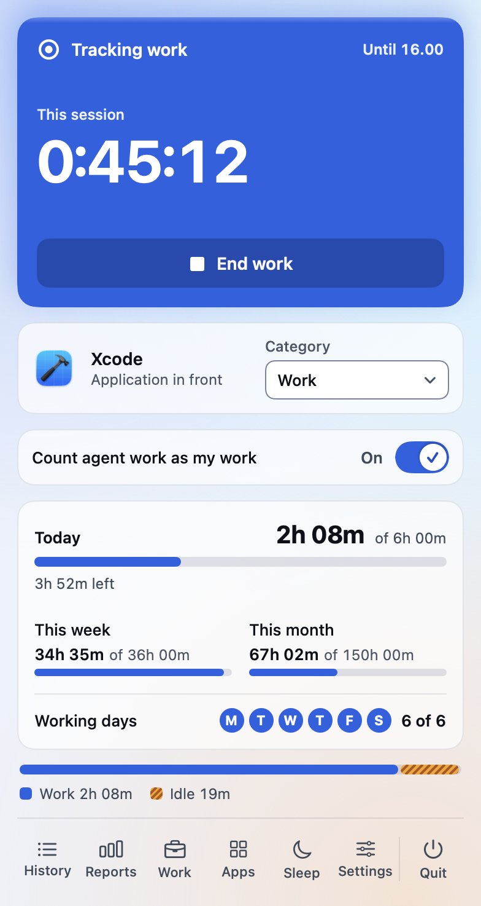
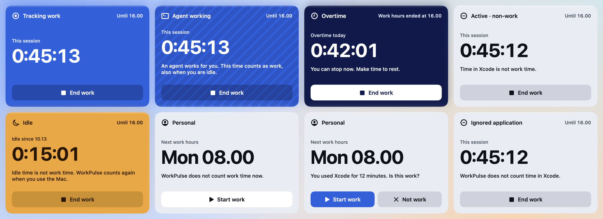
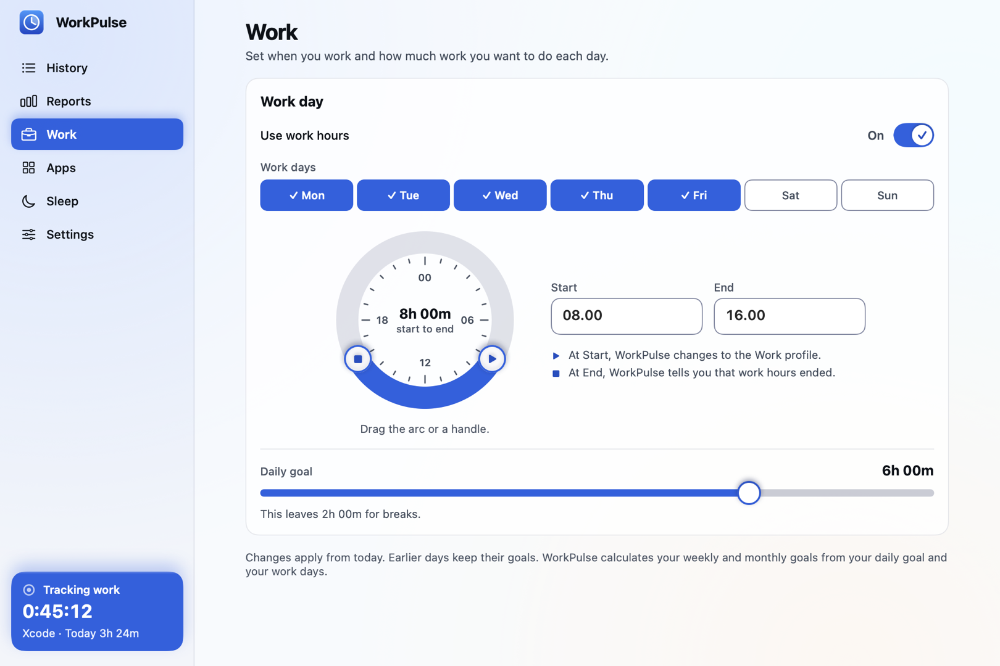
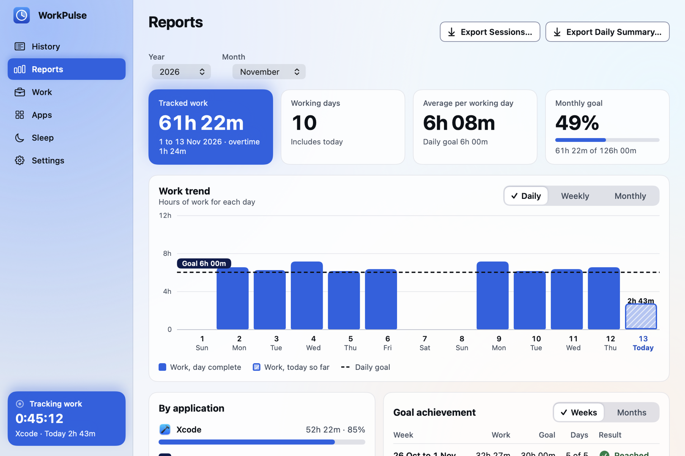

# WorkPulse

[](docs/building.md)
[](LICENSE)
[](https://github.com/sponsors/sayyidsenpai)

A menu bar app for macOS that counts your work time and tells you when you can stop.
Everything stays on your Mac.

<p align="center">
  
</p>

## What it does

- **It counts work by itself.** In your work hours, time in your work applications counts as
  work. Idle time, a locked screen and sleep never count.
- **It tells you when to stop.** You see when you reach your daily goal and when your work hours
  end. Work after that is overtime, and WorkPulse says so.
- **It has two profiles.** Work counts work time. Personal counts none. You change with one
  button: "Start work" or "End work".
- **It counts agent work.** While Claude Code or Codex works on a task for you, that time can
  count as your work, also when you are away.
- **You can correct it.** The history is editable, and reports export to CSV.
- **It can remind you to sleep.** One optional notification before your bedtime.

## Screens

Each status has its own colour, icon and sentence, so you never read the status from colour alone.

<p align="center">
  
</p>

Set your work hours on a 24-hour dial. The daily goal cannot be longer than your work hours.

<p align="center">
  
</p>

Reports show your work for each day, week and month against your goal.

<p align="center">
  
</p>

The pictures show sample data.

## Privacy

- No account, no network connection, no telemetry.
- WorkPulse reads two things: which application is in front, and how long there was no input.
  It does not read keys, screen content, window titles, tabs or URLs.
- Your data is one SQLite file in `~/Library/Application Support/WorkPulse/`. You can back it
  up, restore it and delete it in Settings.

## Install

You need macOS 14 or later and Xcode 15 or later. WorkPulse has no third-party dependencies.

```bash
git clone https://github.com/sayyidsenpai/workpulse.git && cd workpulse
```

```bash
./scripts/build-app.sh
```

```bash
cp -R build/WorkPulse.app /Applications/ && open /Applications/WorkPulse.app
```

WorkPulse opens in the menu bar, not in the Dock. The first launch asks for your work hours,
your daily goal and your work applications.

The application is signed ad hoc and is not notarized, so build it on the Mac that runs it.
[Build, sign and run](docs/building.md) has the details.

## Documentation

- [How tracking works](docs/tracking.md): profiles, work hours, overtime, goals, reports, sleep reminders
- [AI agent work](docs/ai-agents.md): Claude Code and Codex, automatic and manual setup
- [Build, sign and run](docs/building.md): build options, Gatekeeper, permissions
- [Data, architecture and limitations](docs/architecture.md)

## Support

WorkPulse is free and open source. If it saves you time, you can buy me a coffee:
[sponsor me on GitHub](https://github.com/sponsors/sayyidsenpai).

## License

MIT, copyright (c) 2026 sayyidsenpai. See [LICENSE](LICENSE). You may use, change and redistribute
WorkPulse, including commercially, as long as the copyright notice and the license text stay with
every copy or substantial portion of it.
